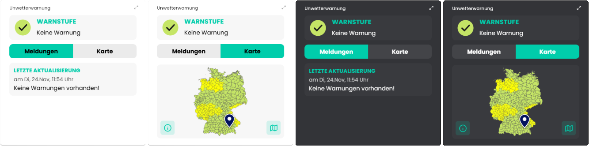
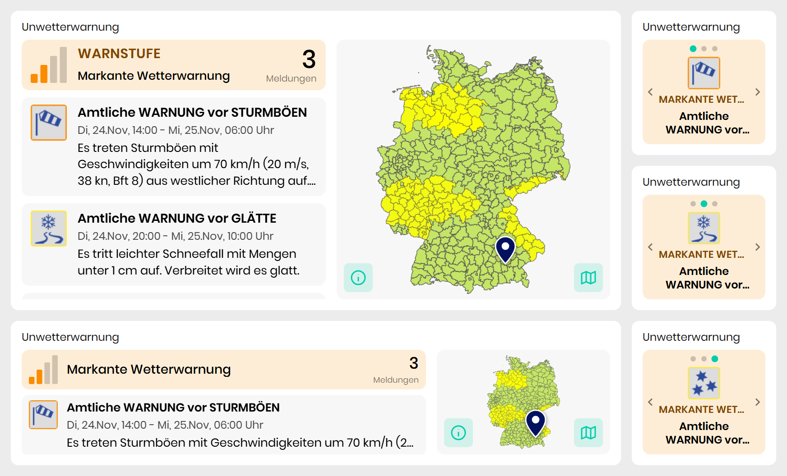

# 🌩️ Unwetterwarnung (Weather Warning)

[](https://wilkware.de/module/unwetterwarnung/)
[](https://www.symcon.de/service/dokumentation/entwicklerbereich/sdk-tools/sdk-php/)
[](https://www.symcon.de/produkt/)
[](https://github.com/Wilkware/WeatherWarning)
[](https://creativecommons.org/licenses/by-nc-sa/4.0/)
[](https://github.com/Wilkware/WeatherWarning/actions)

Dieses Modul dient zum Abrufen der von DWD bereitgestellten Unwetterwarnungen (Gewitter, Stark- und Dauerregen, Schneefall, Wind, Nebel, Frost, Glatteis, Tauwetter, UV-Strahlung, Hitze).



## Inhaltsverzeichnis

1. [Funktionsumfang](#user-content-1-funktionsumfang)
2. [Voraussetzungen](#user-content-2-voraussetzungen)
3. [Installation](#user-content-3-installation)
4. [Einrichtung](#user-content-4-einrichtung)
5. [Statusvariablen](#user-content-5-statusvariablen)
6. [Darstellungen](#user-content-6-darstellungen)
7. [Visualisierung](#user-content-7-visualisierung)
8. [Befehlsreferenz](#user-content-8-befehlsreferenz)
9. [Versionshistorie](#user-content-9-versionshistorie)

### 1. Funktionsumfang

Das Modul nutzt die vom GeoWebservice des deutschen Wetterdienstes (DWD) bereitgestellten WMS-Dienste um (Un)Wetterwarnungen in Symcon zu integrieren.
Je nach ausgewählter Region bzw. Gebietstyp werden die Warnungen gefiltert und in verschiedene Kanäle (Text, HTML, Push-Nachricht) ausgegeben.

Für die Auswahl des Gebietstyps/Region nutzt das Modul eine eigens entwickelte JSON-API (CDN basierend) damit der Nutzer schnell die richtige Gebiets-ID (WARNCELLID) einstellen kann (derzeit 12144).

Für die Kachel-Visualisierung bringt das Modul eine eigene Kachel mit: Warnstufe, Meldungen mit den Warnsymbolen des DWD und die Unwetterkarte mit Legende und wählbarem Kartenausschnitt, passend zur Größe der Kachel.

Darüber hinaus können noch Variablen zur Darstellung verschiedener Wetterbilder und Radarfilme angelegt werden.

### 2. Voraussetzungen

* Symcon ab Version 8.1

### 3. Installation

* Über den Modul Store das Modul _Unwetterwarnung_ installieren.
* Alternativ über das Modul Control folgende URL hinzufügen.  
`https://github.com/Wilkware/WeatherWarning` oder `git://github.com/Wilkware/WeatherWarning.git`

### 4. Einrichtung

* Unter 'Instanz hinzufügen' ist das _Unwetterwarnung_-Modul unter dem Hersteller '(Geräte)' aufgeführt.

__Konfigurationsseite__:

Einstellungsbereich:

> 📍 Warngebiet ...

Entsprechend der gewählten Auswahl verändert sich das Formular dynamisch.
Eine komplette Neuauswahl erreicht man durch Auswahl eines anderen "Gebietstyp" oder durch
"Bitte wählen ..." an der gewünschten Stelle.

Name                       | Beschreibung
-------------------------- | ----------------------------------
Land                       | 'Deutschland'
Warngebiet                 | Auswahl von 6 verschiedenen Warngebieten
Bundesland                 | Auswahl des Bundeslandes welches für den Warntyp verfügbar ist
Landkreis/kreisfreie Stadt | Auswahl des Landkreises oder einer kreisfreien Stadt im Bundesgebiet
Gemeinde                   | Auswahl einer Gemeinde, wenn der Typ diese Auflösung unterstützt (Warntyp: Gemeinden)

> 🗺️ Unwetterkarte ...

Hier kann eine Unwetterübersichtskarte aktiviert und konfiguriert werden. Neben der großen Deutschlandkarte kann auch eine
detailliertere Variante auf Basis des Bundeslandes gewählt werden. Das Erscheinungsbild kann durch verschiedene Parameter angepasst werden.  
Der darzustellende Bereich (so g. Bounding Box) wird dabei durch die Längen- und Breitengrade der 4 Himmelsrichtungen begrenzt!

Name                    | Beschreibung
----------------------- | ---------------------------------
Auswahl                 | Aktiviert Statusvariable für Unwetterkarte bei Auswahl eines konkreten Gebietes, gleichzeitig Vorgabe für den Kartenausschnitt der Kachel
Detailgrad              | Kreis- oder Gemeindeebene (Gemeinde dauert sehr lange zum Generieren)
Hintergrund             | Auswahl des Hintergrundlayers oder transparent
Bildbreite              | Breite in Pixel des zu generierenden Bildes (vordefiniert 500px und die Ration entsprechend in Richtung Höhe)
Bildhöhe                | Höhe in Pixel des zu generierenden Bildes
West                    | Westlicher Breitengrad (Begrenzung der Bildbox im Westen)
Süd                     | Südlicher Längengrad (Begrenzung der Bildbox im Süden)
Ost                     | Östlicher Breitengrad (Begrenzung der Bildbox im Osten)
Nord                    | Nördlicher Längengrad (Begrenzung der Bildbox im Norden)
Markierung anzeigen?    | Schalter, ob Markierung des eigenen Standortes (Location Control) angezeigt werden soll.
Farbe der Markierung    | Farbauswahl für Marker Pin, welcher als Platzhalter {{color}} in der CSS-Definition verwendet werden kann! Gilt auch für den Pin in der Kachel.
Legende (Html)          | Html Vorlage für Legende-Tabelle

> 📡 Bilder und Radarfilm ...

Hier können Bilder bzw. der Radarfilm für die aktuellen Temperaturen und Niederschläge je Bundesland und/oder Deutschland aktiviert werden.  
Das Erscheinungsbild kann wieder über die Stylesheet-Angaben beeinflußt werden.

Name                    | Beschreibung
----------------------- | ---------------------------------
Aktuelle Temperatur     | Darstellung der aktuellen Temperatur zum aktuellen Tageszeitpunkt
Niederschlag Radarbild  | Radarbild des aktuellen Niederschlages zum aktuellen Tageszeitpunkt
Niederschlag Radarfilm  | Animation des aktuellen Niederschlages zum mitlaufenden Tageszeitpunkt

> 🎨 Formatvorlagen ...

Name                    | Beschreibung
------------------------| ---------------------------------
Unwetterkarte           | Style für die Unwetterkarte (Deutschlandkarte mit Pin)
Warnmeldung             | Style für die Warnmeldungen (Tabelle, Icon, Überschrift, Beschreibung und Zeitspanne)
Legende                 | Style für die Legende (Farbskala und deren Zuordnung zu Gefahrenstufen)
ZURÜCKSETZEN            | Schalter, um wieder die jeweilig vordefinierten Stylesheet-Angaben einzusetzen

> 📢 Meldungsverwaltung ...

Name                           | Beschreibung
------------------------------ | ---------------------------------
Meldung an Anzeige senden      | Auswahl ob Eintrag in die Meldungsverwaltung erfolgen soll oder nicht (Ja/Nein)
Ab Stufe der Warnmeldung       | Auswahl ab welcher Stufe (1-4) die Nachricht erfolgen soll
Lebensdauer der Nachricht      | Wie lange soll die Meldung angezeigt werden?
Nachricht an Visualisierung senden | Auswahl ob Push-Nachricht gesendet werden soll oder nicht (Ja/Nein)
Ab Stufe der Warnmeldung       | Auswahl ab welcher Stufe (1-4) die Meldung erfolgen soll
Text in Variable schreiben     | Auswahl ob Nachricht in Statusvariable geschrieben werden soll
Texttrennzeichen/Zeilenumbruch | Trennzeichen bei mehreren Ereignissen
Format der Textmitteilung      | Frei wählbares Format der zu sendenden Nachricht/Meldung
Visualisierungs-Instanz        | ID der Visualisierung, an welches die Push-Nachrichten zu Unwetterwarnungen gesendet werden soll (WebFront oder TileVisu Instanz)
Ton der Benachrichtigung       | Ton der Push-Nachricht (WebFront und Kachel-Visu, Standard: siren)
Meldungsskript                 | Skript ID des Meldungsverwaltungsskripts, weiterführende Infos im Forum: [Meldungsanzeige im Webfront](https://community.symcon.de/t/meldungsanzeige-im-webfront/23473)
Meldungsschlüssel (optional)   | Leer = jede neue Warnung wird einmalig als Meldung hinzugefügt (Entfernen per Klick oder über die Lebensdauer). Mit Schlüssel erhält jede Warnung eine eigene Meldung mit dem Schlüssel `<Schlüssel>.<ID>`, die nach Ende der Warnung automatisch entfernt wird (Meldungsskript ab v8, ältere Skripte ignorieren den Schlüssel).

_Hinweis:_ Push-Nachrichten und Meldungen werden pro Warnung nur einmal gesendet, nicht bei jeder Aktualisierung. Ändert der DWD Inhalt oder Zeitraum einer Warnung, gilt sie als neue Warnung. Nach einem Neustart von Symcon werden die aktiven Warnungen einmalig erneut gemeldet (mit Schlüssel wird die bestehende Meldung nur aktualisiert).

> ✨ Visualisierung ...

Name                                 | Beschreibung
------------------------------------ | ---------------------------------
Schaltfläche Legende                 | Ecke der Karte für die Schaltfläche (i) der Legende oder ausgeblendet (Standard: unten rechts)
Schaltfläche Kartenausschnitt        | Ecke der Karte für die Auswahl des Kartenausschnitts oder ausgeblendet (Standard: oben links)

> ⚙️ Erweiterte Einstellungen ...

Name                                                            | Beschreibung
--------------------------------------------------------------- | ---------------------------------
Indikatorvariable für aktive Warnungen anlegen (höchste Stufe)! | Schalter, ob eine Statusvariable als Indikator für Warnungen (höchste Stufe) angelegt und aktualisiert werden soll.
Variable für Bilderklärung (Legende) anlegen!                   | Schalter, ob eine Statusvariable für die Erklärung der Zuordnung Farbe zu Warnstufe angelegt werden soll.
Aktualisierungsinterval                                         | Auswahl aller wieviel Minuten Informationen abgerufen werden sollen (Standard: 15 min)

Aktionsbereich:

> 🌩️ Wetterwarnungen ...

Aktion         | Beschreibung
-------------- | ------------------------------------------------------------
AKTUALISIEREN  | Ruft die aktuellen Unwetterwarnungen von DWD ab (Update)

### 5. Statusvariablen

Die Statusvariablen werden automatisch angelegt. Das Löschen einzelner kann zu Fehlfunktionen führen.

Ident            | Name                           | Typ     | Beschreibung
---------------- | ------------------------------ | ------- | ------------------------------------------------------------
Level            | Warnstufe                      | Integer | Höchste Warnstufe aller verfügbaren Meldungen
Table            | Warnmeldungen                  | String  | Darstellung aller Meldungen als HTML Tabelle
Text             | Warnnachricht                  | String  | Darstellung aller Meldungen in textuellen Format
Map              | Unwetterkarte                  | String  | Unwetterkarte für Deutschland bzw. das ausgewählte Bundesland
Legend           | Legende                        | String  | Erklärung der Zuordnung Farbe zu Warnstufe
ActTemp          | Temperaturen aktuell           | String  | Aktuelle Temperaturübersichtskarte für ausgewähltes Bundesland
ImgRadar         | Niederschlag Radarbild         | String  | Aktuelles Radarbild (Niederschlag) für ausgewähltes Bundesland
MovRadar         | Niederschlag Radarfilm         | String  | Aktueller Radarfilm (Niederschlag) für ausgewähltes Bundesland
ISOActTemp       | Temperaturen aktuell (de)      | String  | Aktuelle Temperaturübersichtskarte für Deutschland
ISOImgRadar      | Niederschlag Radarbild (de)    | String  | Aktuelles Radarbild (Niederschlag) für Deutschland
ISOMovRadar      | Niederschlag Radarfilm (de)    | String  | Aktueller Radarfilm (Niederschlag) für Deutschland
ISOMovForecast   | Niederschlags Vorhersage (de)  | String  | Niederschlagsvorhersage für Deutschland

_Hinweis:_ Bis auf _Warnmeldungen_ werden die Statusvariablen nur entsprechend der Auswahl in der Konfiguration angelegt.

### 6. Darstellungen

Die Darstellungen werden direkt an den Statusvariablen hinterlegt, es werden keine Profile angelegt.

Variable                       | Darstellung   | Werte
------------------------------ | ------------- | ------------------------------------------------------------
Warnstufe                      | Wertanzeige   | Keine Warnung (0), Wetterwarnung (1), Markante Wetterwarnung (2), Unwetterwarnung (3), Extreme Unwetterwarnung (4), UV-Warnung (10, 12), Hitzewarnung (11), Extreme Hitzewarnung (13)
Warnmeldungen                  | Webinhalt     | HTML
Warnnachricht                  | Wertanzeige   | Text (Icon: message-exclamation)
Unwetterkarte                  | Webinhalt     | HTML
Legende                        | Webinhalt     | HTML
Temperaturen aktuell (...)     | Webinhalt     | HTML
Niederschlag Radarbild (...)   | Webinhalt     | HTML
Niederschlag Radarfilm (...)   | Webinhalt     | HTML
Niederschlags Vorhersage (de)  | Webinhalt     | HTML

### 7. Visualisierung

Das Modul bringt eine eigene Kachel für die Kachel-Visualisierung mit (Instanz direkt in die Visualisierung einfügen).
Die Kachel passt ihr Layout an die Größe an:

* __Klein__ (z. B. 1×1): Warnstufe und Meldungen zum Durchblättern
* __Mittel__ (z. B. 2×2): Warnstufe, Umschaltung zwischen Meldungen und Karte
* __Groß__ (z. B. 4×2): Warnstufe und Meldungen neben der Unwetterkarte
* __Flach__ (z. B. 4×1): kompakte Meldungen neben einer schmalen Karte



Oben steht immer die Gesamtlage: eine Stufenskala (1 bis 4 Balken in der Farbe der höchsten Warnstufe, ohne Warnung ein grünes Häkchen),
die Warnstufe als Text und die Anzahl der Meldungen. Darunter folgen die einzelnen Meldungen mit dem Warnsymbol des DWD, Zeitraum und Beschreibung
(antippen klappt die Beschreibung auf). Schlägt der Abruf fehl, zeigt die Kachel die zuletzt bekannten Warnungen mit einem Hinweis auf den Stand der Daten.

Auf der Karte blendet (i) die Legende ein, über das Kartensymbol lässt sich der Kartenausschnitt (Deutschland, Bundesländer) wechseln.
In welcher Ecke der Karte die beiden Schaltflächen sitzen (oder ob sie ausgeblendet sind), wird in der Konfiguration festgelegt.
Kartenausschnitt und gewählte Ansicht (Meldungen oder Karte) werden pro Gerät gemerkt, Vorgabe sind der in der Konfiguration gewählte Ausschnitt und die Meldungen.
Farben und Schrift kommen vom gewählten Theme der Visualisierung, die Warnsymbole und die Karte direkt vom DWD.

Alternativ kann man weiterhin die Statusvariablen direkt in die Visualisierung verlinken.

### 8. Befehlsreferenz

```php
void UWW_Update(int $InstanzID):
```

Holt entsprechend der Konfiguration die gewählten Daten vom Deutschen Wetterdienst (DWD).  
Die Funktion liefert keinerlei Rückgabewert.  
__HINWEIS:__ Schlägt der Abruf fehl, bleiben die zuletzt erfolgreich geladenen Warnungen stehen (abgelaufene Warnungen werden ausgeblendet),
Tabelle und Kachel zeigen einen Hinweis mit dem Stand der Daten und die Instanz wechselt in den Status 201. Push-Nachrichten und Meldungen werden in diesem Fall nicht versendet.
Nach einem Neustart von Symcon ist bis zum ersten erfolgreichen Abruf kein Stand vorhanden.

__Beispiel__: `UWW_Update(12345);`

```php
void UWW_WarningInfo(int $InstanzID):
```

Gibt alle Unwetterwarnungen als multidimensionales assoziatives Array zurück.
__HINWEIS:__ Sollten keine Warnungen vorliegen, wird ein leeres Array geliefert.

__Beispiel__: `UWW_WarningInfo(12345);`

> \[{  
> "AREA": "Chiemsee",  
> "WARNCELLID":209913000,  
> "SENT":"2021-05-10 12:51:00",  
> "STATUS":"Aktuelle Meldung",  
> "TYPE":"Erstausgabe der Meldung",  
> "CATEGORY":"Meteorologische Meldung",  
> "EVENT":"STARKWIND",  
> "URGENCY":"Warnung",  
> "SEVERITY":"Wetterwarnung",  
> "LEVEL":1,  
> "CERTAINTY":"Vorhersage, Auftreten wahrscheinlich (p > ~50%)",  
> "CODE":"57:Starkwind",  
> "GROUP":"WIND",  
> "TIMESTAMP":"2021-05-10 12:51:00",  
> "START":"2021-05-10 12:51:00",  
> "END":"",  
> "HEADLINE": "Warnung vor Starkwind",  
> "DESCRIPTION":"Es treten Windb\u00f6en mit Geschwindigkeiten bis 60 km\/h (17m\/s, 33kn, Bft 7) auf.",  
> "INSTRUCTION":""  
> }\]  

### 9. Versionshistorie

v4.0.20261124

* _NEU_: Eigene Kachel für die Kachel-Visualisierung (größenabhängiges Layout, Stufenskala, Meldungen mit DWD-Symbolen, Unwetterkarte mit Legende)
* _NEU_: Kartenausschnitt und Ansicht der Kachel direkt in der Kachel wählbar und pro Gerät gemerkt, Position der Schaltflächen auf der Karte einstellbar
* _NEU_: Kompatibilität auf Symcon 8.1 hoch gesetzt
* _NEU_: Ton der Push-Nachricht ist jetzt einstellbar
* _NEU_: Optionaler Meldungsschlüssel für das Meldungsskript (eigene Meldung pro Warnung, automatisches Entfernen nach Ende der Warnung)
* _NEU_: Push-Nachrichten und Meldungen werden pro Warnung nur noch einmal gesendet
* _NEU_: Schlägt der Abruf fehl, bleiben die zuletzt bekannten Warnungen stehen (inkl. Hinweis und Instanzstatus 201)
* _NEU_: Konfigurationsformular auf Standardlayout umgestellt (inkl. Versionsanzeige)
* _NEU_: Daten werden direkt nach dem Übernehmen der Konfiguration und nach dem Start von Symcon aktualisiert
* _NEU_: Darstellungen der Statusvariablen bereinigt, Warnstufe und Warnnachricht mit Icon
* _NEU_: Timeout für Abfragen, robustere Auswertung der DWD-Daten
* _NEU_: Warnsymbole kommen wieder direkt vom DWD (aktueller Symbolsatz), Symbol für "Keine Warnungen" ist eingebettet
* _FIX_: Veraltete Funktion strftime ersetzt, Datumsangaben und Texte der Tabelle übersetzbar
* _FIX_: Standortmarkierung auf der Karte bei fehlendem Standort oder ungültigem Kartenausschnitt
* _FIX_: Farbe der Standortmarkierung wurde bei Farben mit führenden Nullen falsch gesetzt
* _FIX_: Fehlgeschlagener Abruf wurde als "Keine Warnungen vorhanden" angezeigt
* _FIX_: Ungültiger Ton bei Push-Nachrichten an das WebFront
* _FIX_: Fehlende Übersetzungen im Formular korrigiert, nicht mehr benötigte Übersetzungen entfernt
* _FIX_: Dokumentation überarbeitet

v3.1.20250802

* _NEU_: Niederschlagsradar-Vorhersage hinzugefügt

v3.0.20250801

* _NEU_: Icons werden jetzt via github-Pages geladen (bessere Ausfallsicherheit)
* _NEU_: HTML für Legende in Konfiguration aufgenommen
* _NEU_: Continuous Integration mit Check Style, Static Code Analysis und Unit Tests eingeführt
* _NEU_: Debugging Funktionen komplett überarbeitet
* _FIX_: Update der Event-Tabelle für korrekte Zurodnung von Ereignis zu Icon
* _FIX_: Zeiten korrigiert (TimeZone wird jetzt korrekt gesetzt)
* _FIX_: Meta-Tag für viewport gelöscht, kommt automatisch vom System
* _FIX_: Farben der Profilassoziationen passenend zu Symbolfarbe
* _FIX_: (Warn)Symbole hür Hitze und UV werden jetzt korrekt gesetzt
* _FIX_: Warnungskategorie `Health` korrigiert
* _FIX_: Dokumentation für PHP Static Analysis komplett überarbeitet
* _FIX_: Bibliotheksfunktionen überarbeitet in Vorbereitung auf IPSModuleStrict

v2.0.20240811

* _NEU_: Darstellung der Farbskala der Warnstufen (Legende)
* _NEU_: Medizin-Meteorologische Meldung (Hitzewarnungen) werden speziell behandelt (Level)
* _NEU_: Stylesheets können für alle HTML-Elemente individuell definiert werden
* _NEU_: Farbauswahl für Karten-Pin kann durch Platzhalter {{color}} im Stylesheet verwendet werden
* _NEU_: Kompatibilität auf IPS 6.4 hoch gesetzt
* _FIX_: Icon für extreme Hitze wird jetzt korrekt angezeigt
* _FIX_: HTML-Struktur vereinheitlicht und verbessert
* _FIX_: Unterscheidung der verschiedenen Visualisierungsinstanzen (PushNotification)
* _FIX_: Bibliotheks- bzw. Modulinfos vereinheitlicht
* _FIX_: Namensnennung und Repo vereinheitlicht
* _FIX_: Update Style-Checks
* _FIX_: Übersetzungen überarbeitet und verbessert
* _FIX_: Dokumentation vereinheitlicht 

v1.7.20230709

* _NEU_: Anpassungen für IPS 7.0 (PHP 8.2)
* _FIX_: Veraltetet Style-Checks ausgebaut
* _FIX_: Weitere Modulvereinheitlichungen vorgenommen
* _FIX_: Fehler in Auswertung von Warnungen korrigiert
* _FIX_: Fehler bei Umlauten in Meldungsüberschrift (MultiByte)

v1.6.20220114

* _NEU_: Kompatibilität auf IPS 6.0 hoch gesetzt
* _NEU_: Bibliotheks- bzw. Modulinfos vereinheitlicht
* _NEU_: Konfigurationsdialog überarbeitet (v6 Möglichkeiten genutzt)
* _NEU_: Doppelte Warnungen bei Meldungsverwaltung entfernt
* _FIX_: Fehlende Text-Formatierung für Warnungen hinzugefügt
* _FIX_: Fehler in Modulbibliotheken korrigiert

v1.5.20210801

* _FIX_: Fehlende Text-Formatierung für Warnungen hinzugefügt
* _FIX_: Icon wird jetzt bei allen Warnungen korrekt angezeigt
* _FIX_: Weitere Modulvereinheitlichungen vorgenommen
* _FIX_: Dokumentation überarbeitet

v1.4.20210611

* _NEU_: Positions-Marker auf Unwetterkarte hinzugefügt
* _FIX_: Inline Style für Unwetterkarte vereinheitlicht/umgestellt

v1.3.20210609

* _NEU_: Text-Formatierung erweitert
* _NEU_: Inline-Style Angaben für Unwetterkarte
* _FIX_: Warnstufen-Icon für Stufe 3 und 4
* _FIX_: Lebensdauer einer Meldung von Sekunden auf Minuten korrigiert
* _FIX_: URL-Parameter für Umweltkarte vereinheitlicht
* _FIX_: Zuweisung der Formatvorlagen für Meldungstabelle korrigiert
* _FIX_: Dokumentation korrigiert

v1.2.20210518

* _NEU_: Text-Formatierung um Warnstufe(Zahl) und Beschreibung erweitert
* _NEU_: Unwetterkarte auf GeoWebservice umgestellt
* _FIX_: Temperatur- und Niederschlagsbilder jetzt mit umschließendem DIV; IMG fixer Style
* _FIX_: MV korrekt geschrieben

v1.1.20210511

* _NEU_: Temperatur, Niederschlag und Radarfilm auch für ganz Deutschland auswählbar
* _FIX_: Keine Auswahl des Warngebietes möglich, Instanz blieb inaktiv
* _FIX_: Dokumentation vervollständigt

v1.0.20210313

* _NEU_: Initialversion

## Danksagung

Ich möchte mich für die Unterstützung bei der Entwicklung dieses Moduls bedanken bei ...

* _Fonzo_ : für das beharrliche Nachfragen nach dem Modul ;-)
* _Nall-chan_ : für die Hilfe im Channel und seine tollen Lösungen ;-)
* _yansoph_: für den regen Austausch und das Testen :-)
* _richimaint_: für das Testen beim Umlauteproblem :-)

Vielen Dank an Euch!

## Entwickler

Seit nunmehr über 10 Jahren fasziniert mich das Thema Haussteuerung. In den letzten Jahren betätige ich mich auch intensiv in der Symcon Community und steuere dort verschiedenste Skript und Module bei. Ihr findet mich dort unter dem Namen @pitti ;-)

[](https://wilkware.github.io/)

## Spenden

Die Software ist für die nicht kommerzielle Nutzung kostenlos, über eine Spende bei Gefallen des Moduls würde ich mich freuen.

[](https://www.paypal.com/cgi-bin/webscr?cmd=_s-xclick&hosted_button_id=8816166)

## Lizenz

Namensnennung - Nicht-kommerziell - Weitergabe unter gleichen Bedingungen 4.0 International

[](https://creativecommons.org/licenses/by-nc-sa/4.0/)
